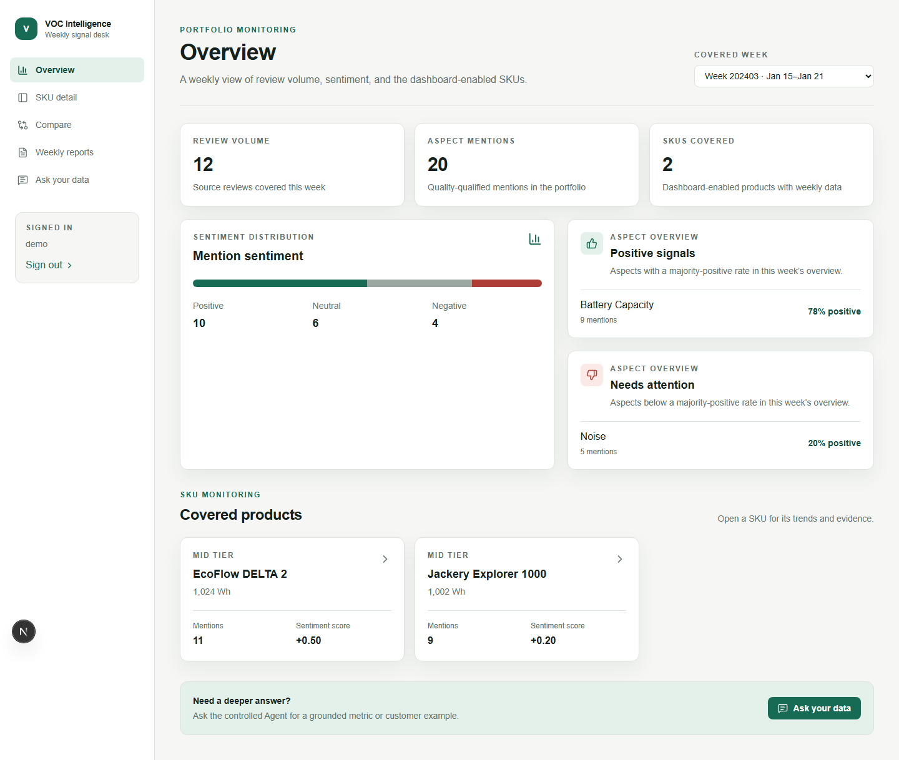
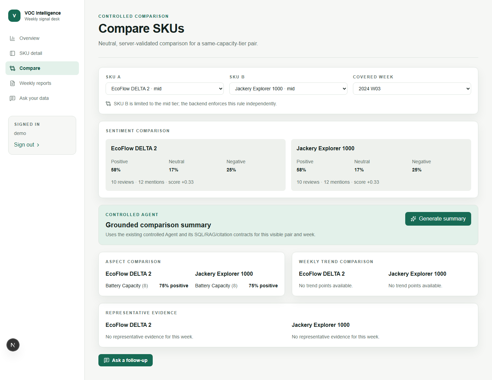
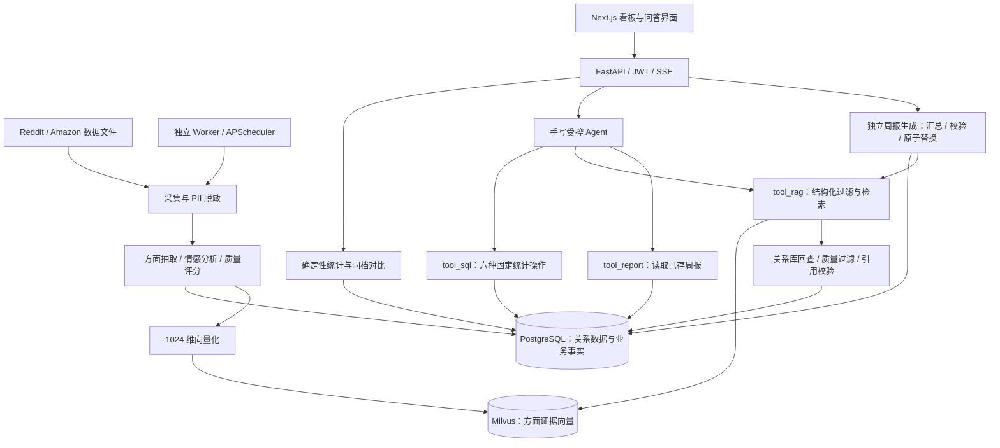

# VOC Agent｜客户之声分析系统

**从分散的用户评论中提取产品信号，形成可追溯的分析与回答。**

VOC Agent 面向便携储能产品的产品、市场与用户洞察场景，将 Reddit / Amazon 评论处理、
方面级情感分析、周度看板、同容量档位竞品对比，以及 SQL / RAG 问答串联为完整应用。
用户既能查看“某周哪些产品和问题值得关注”，也能继续追问并定位到支撑回答的评论证据。

本项目是面向后端与 AI 应用开发岗位的工程实践，采用 **FastAPI + PostgreSQL + Milvus +
Next.js + TypeScript**。核心设计是让模型负责工具选择和语言组织，让代码负责统计、
业务规则、证据校验与持久化。目前交付范围为五个固定 SKU 的本地 MVP，公开真实评论业务验收仍在推进。

[现有功能](#现有功能) · [运行截图](#运行截图) · [系统架构](#系统架构) ·
[工程设计](#工程设计) · [部署与运行](#部署与运行) · [验证证据](#验证证据)

## 现有功能

| 模块 | 已实现能力 |
| --- | --- |
| 数据处理 | 支持 Reddit 接入和本地 Amazon 数据文件；PII 脱敏、方面与情感抽取、质量评分、向量化；按文档维护处理状态，单条失败不阻塞其他文档。 |
| 周度概览 | 按周查看评论量、方面提及量、情感分布、正向信号、待关注问题与 SKU 列表。 |
| SKU 详情 | 查看单个产品的周度指标、方面分布、趋势与符合质量门槛的证据。 |
| 同档对比 | 对比同容量档位产品的指标、方面与证据；后端独立拒绝跨档对比。 |
| 受控问答 | 手写 function-calling 循环，组合周报读取、固定 SQL 统计与 RAG 检索；支持最近可见对话的追问、SSE 回答与引用卡片。 |
| 周报生成 | 汇总确定性统计与检索证据，校验候选报告后原子落库；生成或替换失败时保留旧报告。 |
| 会话与认证 | 单密码登录、JWT 会话、聊天记录持久化；问答和周报生成需要认证。 |
| 工程交付 | Python wheel、非 root 容器镜像、隔离 Compose、前后端 CI、容器故障恢复验证，以及精确到本次运行 ID 的验收工具。 |

## 运行截图

以下为 **2026-10-23 在 Chromium 中拍摄的真实 Next.js 页面**。
截图使用基于组件测试的合成 API 数据，展示界面与交互布局，不代表真实评论结论或后端／模型联调结果。
拍摄方式与复现命令见[截图说明](docs/images/README.md)。

### 周度产品概览



### 同容量档位产品对比



此演示保留了无趋势、无证据时的空状态；未填入虚构的客户引文，也未调用模型生成对比总结。

## 系统架构



PostgreSQL 保存评论、方面提及、统计所需数据、会话与报告；Milvus 主键与
`aspect_mentions.id` 保持一致。检索后回查关系库，回答引用只允许使用实际采用的有效证据。
周报生成是独立工作流，Agent 的 `tool_report` 只读取已存报告。

| 层次 | 技术 |
| --- | --- |
| 后端与任务 | Python 3.11+、FastAPI、SQLAlchemy asyncio、asyncpg、Alembic、APScheduler |
| 数据与检索 | PostgreSQL 15、Milvus 2.3.4、etcd、MinIO、1024 维 embedding |
| 模型与处理 | OpenAI 兼容 SDK、Pydantic、Presidio、PRAW |
| 前端 | Next.js 16、React 19、TypeScript、Tailwind CSS 4、TanStack Query、Recharts |
| 验证与交付 | pytest、Ruff、Vitest、ESLint、TypeScript、Playwright、Docker Compose、GitHub Actions |

## 工程设计

| 设计 | 解决的问题 | 实现入口 |
| --- | --- | --- |
| 统计和规则由代码执行 | 模型不能执行自由生成的 SQL；质量阈值、容量档位、计算和参数校验有明确边界。 | [SQL 工具](backend/app/agent/tool_sql.py) |
| 检索与引用分离校验 | 向量命中后回查 PostgreSQL，验证证据与来源，避免将相似文本直接当成可靠引用。 | [架构与来源契约](docs/arch.md) |
| 有限 Agent 循环 | 每轮用户请求最多尝试三个工具、八轮模型调用；首次无工具且缺乏依据的回答有一次受限纠正机会。 | [Agent 详细说明](docs/technical-guide.md#controlled-agent) |
| 成功事件晚于提交 | Ask 消息与引用提交后再发送最终成功事件；周报候选校验失败或取消时保留已有报告。 | [问答接口](backend/app/api/ask.py)、[周报接口](backend/app/api/reports.py) |
| 验收绑定具体运行 | 以 run/session/message/report ID 审计本次结果，避免把旧会话或旧报告误判成本轮成功。 | [验收工具说明](docs/development/verification.md) |

## 部署与运行

以下命令从仓库根目录执行，开发示例采用 PowerShell。项目已交付本地部署与隔离容器启动方案，
公网生产部署不在当前验收范围内。

### 方式一：快速启动容器演示环境

前置条件：Docker Engine / Docker Desktop 已启动，Compose 版本不低于 2.24.4。
以下方案使用独立的 `voc-demo` 项目和固定测试向量服务，无需模型密钥。

```powershell
docker compose --env-file ops/compose.empty.env -p voc-demo -f ops/docker-compose.yml -f ops/compose.smoke.yml --profile smoke up --build -d --wait
```

- 页面：<http://127.0.0.1:13000/overview>，本地演示密码：`local-container-only`。
- API 健康检查：<http://127.0.0.1:18000/health>。
- 初始数据库只有五个 SKU，没有评论和周度数据，页面会显示空状态；测试服务不提供聊天模型。
  README 截图通过独立的浏览器 fixture 拍摄，不会由此空数据库自动生成。
- 此方案仅绑定本机端口，固定演示密码不能用于公网环境。

停止演示环境并保留数据卷：

```powershell
docker compose --env-file ops/compose.empty.env -p voc-demo -f ops/docker-compose.yml -f ops/compose.smoke.yml --profile smoke down
```

如需自动执行启动、维度错误拒绝、初始化失败阻断与恢复检查，可运行：

```powershell
python scripts/run_container_smoke.py --build
```

该脚本创建并清理自己专属的隔离项目。完整范围见[容器交付指南](ops/README.md)。

### 方式二：源码开发与完整功能运行

前置条件：Python 3.11+、uv、Node.js 20+、npm、Docker Compose；完整功能还需要
兼容的聊天与 embedding 服务，embedding 输出必须为 **1024 维**。

**1. 安装依赖并配置环境。**

```powershell
uv sync --locked --extra dev
Push-Location frontend
npm ci
Pop-Location
if (-not (Test-Path .env)) { Copy-Item .env.example .env }
```

已有 `.env` 时保留原配置。编辑 `.env`，至少检查以下变量；不要将密钥提交到 Git：

| 配置 | 用途 |
| --- | --- |
| `DATABASE_URL`、`POSTGRES_USER`、`POSTGRES_PASSWORD`、`POSTGRES_DB` | API／迁移与 Compose 使用一致的数据库配置 |
| `MILVUS_HOST`、`MILVUS_PORT`、`MILVUS_COLLECTION_NAME` | 向量数据库连接与集合 |
| `LLM_API_KEY`、`LLM_BASE_URL`、`LLM_MODEL` | 聊天与抽取服务 |
| `EMBEDDING_API_KEY`、`EMBEDDING_BASE_URL`、`EMBEDDING_MODEL`、`EMBEDDING_DIMENSIONS` | embedding 服务，维度固定为 1024 |
| `ADMIN_PASSWORD`、`JWT_SECRET_KEY` | 登录密码与会话签名，替换示例值 |
| `REDDIT_CLIENT_ID`、`REDDIT_CLIENT_SECRET`、`REDDIT_USER_AGENT` | 运行 Reddit 采集时配置 |

完整配置和前端构建时环境变量说明见[技术指南](docs/technical-guide.md#prerequisites)。

**2. 启动基础设施、迁移数据库并初始化产品元数据。**

```powershell
docker compose up -d
uv run alembic -c alembic.ini upgrade head
uv run python -m backend.app.db.seed
```

根目录 Compose 用于源码开发依赖，与方式一的隔离应用栈用途不同。
如果 Milvus／MinIO 镜像拉取失败，先查阅[已记录的镜像兼容与下载限制](ops/README.md#images-and-configuration)。

**3. 在不同终端启动 API、前端与可选 Worker。**

```powershell
# 终端一：API
uv run uvicorn backend.app.main:app --host 127.0.0.1 --port 8000
```

```powershell
# 终端二：前端
Push-Location frontend
$env:NEXT_PUBLIC_API_BASE_URL = "http://127.0.0.1:8000"
npm run dev
```

```powershell
# 可选终端三：周期采集任务
uv run python -m backend.worker.main
```

打开 <http://localhost:3000>，使用 `ADMIN_PASSWORD` 登录。
API 健康检查为 <http://127.0.0.1:8000/health>，开发接口文档为 <http://127.0.0.1:8000/docs>。
Worker 默认每周日 UTC 02:00 调度处理；调度初始化与实际执行成功是不同的验证事项。

**4. 准备数据。** SKU 初始化不会产生评论或向量。确认来源、提供商与隔离目标后，
可按[技术指南](docs/technical-guide.md#how-to-run)运行真实处理链路或合成演示种子。
相关操作会写入数据并可能调用付费模型；现有十条合成 mention 只用于回归，不代表真实市场样本。

## 验证证据

以下为指定历史提交的记录，**不是本次文档更新重新执行的业务测试**。
详情见[验证证据索引](docs/validation-evidence.md)。

| 层次 | 已记录结果 | 证据与适用范围 |
| --- | --- | --- |
| 后端 CI | Linux 307 测试通过；wheel 内容与六个安装导入检查通过 | [Backend CI](https://github.com/Dkgo-0323/Voc-Agent/actions/runs/39722565442)，提交 `8978982`，确定性验证。 |
| 前端 CI | 54 测试通过，生产构建成功 | [Frontend CI](https://github.com/Dkgo-0323/Voc-Agent/actions/runs/39722565505)，同一提交，组件测试与构建。 |
| 容器交付 | 启动、重复 seed、网络隔离、维度拒绝、初始化失败与恢复通过 | [Container CI](https://github.com/Dkgo-0323/Voc-Agent/actions/runs/39722565560)，使用测试向量，不验证语义效果。 |
| 语义评测 | 50 条受控样例，回答平均评分 99%，确定性数值检查 100%，记录中的关键违规为零 | [逐样例结果](artifacts/eval/phase13_fixture_live_judge.json)，合成回答 + 真实 judge，不是 50 次真实 Agent 执行。 |
| 历史浏览器 E2E | 最终四用例套件记录为通过 | [Phase 14 交接](docs/week4_phase14_handoff.md)，合成数据 + 真实服务／提供商；更新后的精确运行验收工具尚未完成真实复跑。 |

本地常用离线检查：

```powershell
uv run ruff check backend pipelines shared scripts tests conftest.py ops
uv run python scripts/run_backend_tests.py
Push-Location frontend
npm run lint
npm run typecheck
npm test
npm run build
Pop-Location
```

公开真实评论导入、代表性数据效果、当前版本浏览器业务验收与公网部署仍有待完成。
评测门槛、合成样例得分和页面截图分别表达不同证据，不等同于生产准确率。

## 当前边界与取舍

- 固定五个 SKU，采用单密码／JWT；尚未交付多用户身份、RBAC 与租户隔离，浏览器 token 保存在 local storage。
- Ask 引用可以追溯到 mention ID；周报尚无持久化的 report-to-mention 关联，因此不展示逐结论引用卡片。
- 模型输出仍有不确定性；工具与轮数上限约束 Agent 执行，独立请求守卫尚未接入真实运行器，不构成费用硬上限。
- embedding 维度与客户端版本有兼容约束，更换模型需要协调重建向量或迁移。

## 文档导航

- [技术指南与演示流程（英文）](docs/technical-guide.md)
- [验证证据与适用范围](docs/validation-evidence.md)
- [截图来源与复现](docs/images/README.md)
- [详细架构](docs/arch.md)与[数据契约](docs/data_contracts.md)
- [容器交付](ops/README.md)与[验收命令](docs/development/verification.md)（含Playwright借用共享API与回执交接；完整受控浏览器运行器尚待接通）
- [当前计划](docs/development/plan.md)与[交付记录](docs/development/journal.md)
